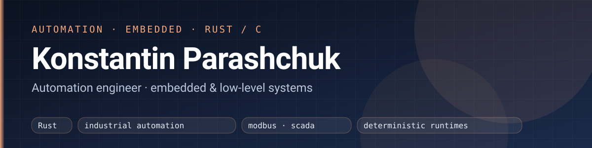

# Konstantin Parashchuk

### Automation engineer · embedded & low-level systems · Rust / C / Python

**I build the software where industrial automation meets low-level engineering:** Modbus and SCADA tooling, deterministic runtimes, reversible computing, CAD/EDA automation and agent memory.

 ·  ·  ·  ·  ·  ·  ·  · 

---

## 🧭 What I do

Most of my repositories are **experiments rather than finished products** —
I like exploring unconventional ideas and learning how complex systems work from the inside.
Each one now carries a tagged release as a starting point, and the tree is the source of truth.

Areas I keep coming back to:

- **Deterministic / real-time systems** — pushing every decision to compile time; OS kernels, RTOS, event-driven runtimes
- **Embedded & low-level C / C++** — branchless fixed-point math, lock-free primitives, FPU-less MCUs, old-style text rendering
- **MIME-as-Storage** — a whole ecosystem built around the idea that *everything should be `.eml`*
- **Agent memory & orchestration (SINT)** — hash-chain provenance, semantic registers, multi-agent MCP tooling
- **Industrial automation** — PLCs, SCADA, Modbus, AutoCAD electrical tooling, GOST document pipelines
- **Graphics & game engines** — Vulkan/OpenGL, sparse-world simulation, image upscaling

---

## 🚀 Now

- **CapsuleCraft** — the flagship: a local-first knowledge base where every note is an `.eml` file. Rust + egui native shell, React web build, eight themes, offline AI integrations.
- **mbSCADA** (`mbscada-rs`) and **`cadcraft`** — the two automation products: a Modbus Poll-grade SCADA client and an AutoCAD-compatible drafting tool, both written from scratch.
- **DSO / PHASE / SINT** — research track: deterministic runtimes and reversible computing on one side, hash-chained agent memory and MCP tooling on the other.
- **Every public repository** carries a tagged release, a README with a CI/release/licence badge row, and — where a build recipe is reproducible — a green GitHub Actions check.

## ⭐ Selected work

| Project | What it is | ★ |
|---|---|---|
| [**CapsuleCraft**](https://github.com/kostyk348/CapsuleCraft) | Local-first note editor and planner where every note is a real RFC 5322 `.eml` file — no database, no cloud. Rust + egui shell, React web build. | 30 |
| [**mbSCADA**](https://github.com/kostyk348/mbscada-rs) | Modbus Poll + SCADA on Rust/Tauri 2: Modbus TCP·RTU·ASCII, byte-exact `.mbp`/`.mbw` round-trip, per-row rules, mimic diagrams, sparklines, CSV log. | 6 |
| [**cadcraft**](https://github.com/kostyk348/cadcraft) | Open-source computer-aided design and drafting: AutoCAD-style command line, object snaps, layers, DXF. | — |
| [**DSO-Controllab**](https://github.com/kostyk348/DSO-Controllab) | Deterministic Systems Optimization — verified execution plans and resource contracts for control systems. | 4 |
| [**pdf-translate**](https://github.com/kostyk348/pdf-translate) | Layout-preserving PDF translation, 30+ languages, local DeepLX backend, no API key. | 4 |
| [**mime-os**](https://github.com/kostyk348/mime-os) | Single-file `.eml` container OS stack: mmap reader, hash-chained delta log, KV, IPC bus, tag-DB. | 3 |
| [**MPTC**](https://github.com/kostyk348/MPTC) | Multi-Phase Ternary Computing — branchless fixed-point C99 for ultra-low-power MCUs. | 2 |
| [**DSO-TRON**](https://github.com/kostyk348/DSO-TRON) | Deterministic RTOS kernel in the μITRON 4.0 tradition: static allocation, lock-free IPC, time-triggered scheduling. | 2 |

All 115 public repositories: [browse](https://github.com/kostyk348?tab=repositories).

## 🌐 Sites

| Site | What's there |
|---|---|
| [**kostyk348.github.io**](https://kostyk348.github.io) | Personal site (Hugo + GitHub Pages): project write-ups, DSO/PHASE notes, blog |
| [**Lost-Tech Museum**](https://kostyk348.github.io/lost-tech-museum/) | A museum of forgotten engineering: digests of papers, patents, RFCs and dead standards, every finding traced to a primary source |

## 🎛 Industrial Automation & Tooling

- [**mbSCADA**](https://github.com/kostyk348/mbscada-rs) — Modbus Poll–grade SCADA client: TCP/RTU/ASCII, byte-exact session round-trip, mimic diagrams, sparklines, CSV logging (Rust + Tauri 2)
- [**mbparse**](https://github.com/kostyk348/mbparse) — zero-dependency Modbus RTU/TCP frame analyzer: parse, validate, explain (C)
- [**doc-generator**](https://github.com/kostyk348/doc-generator) — offline GOST document generator: outgoing letters, memos, forms, name declension, PDF/.eml/.doc export
- [**pdf-spec-parser**](https://github.com/kostyk348/pdf-spec-parser) — procurement PDF spec parser & obfuscator, GOST CID support
- [**passport-to-uml**](https://github.com/kostyk348/passport-to-uml) — extract functional UML diagrams from technical passport PDFs
- [**autocad-electrical-plugin**](https://github.com/kostyk348/autocad-electrical-plugin) — AutoCAD 2024 .NET: electrical topology, AW33 specs, XData, OMNI revisions (C#)
- [**el-tools**](https://github.com/kostyk348/el-tools) — AutoLISP for electrical schematics: circuit tracing, defectoscope, wire specs
- [**omni**](https://github.com/kostyk348/omni) — DWG revision management from AutoCAD: snapshots, overlay compare, rollback

---

## 🔭 Side quests

- [**lost-tech-museum**](https://kostyk348.github.io/lost-tech-museum/) — a museum of lost technologies: digests of patents, RFCs and standards, with every finding traced to a primary source
- [**kostyk348.github.io**](https://kostyk348.github.io) — personal site (Hugo + GitHub Pages): DSO projects, notes, blog

---

## 🧮 Deterministic & reversible computing

- [**DSO-TRON**](https://github.com/kostyk348/DSO-TRON) / [**dso-tron-esp32**](https://github.com/kostyk348/dso-tron-esp32) — deterministic RTOS kernel and its ESP32 (Xtensa LX6) port
- [**dso-runtime**](https://github.com/kostyk348/dso-runtime) — deterministic task-graph execution framework: arena allocation, static scheduling
- [**dso-browser**](https://github.com/kostyk348/dso-browser) — content-centric networking stack: PSIRP + DSO deterministic core
- [**dso-ai-runtime**](https://github.com/kostyk348/dso-ai-runtime) — streaming INT8 LLM inference engine (C++ + AVX2), static arenas
- [**phase-vm**](https://github.com/kostyk348/phase-vm) — reversible register machine: every op writes one destination, the inverse is always computable, no logs
- [**phase-math**](https://github.com/kostyk348/phase-math) / [**phase-arch**](https://github.com/kostyk348/phase-arch) — reversible math on Z/2^64 and the PHASE architecture spec
- [**ternary-vm**](https://github.com/kostyk348/ternary-vm) — balanced-ternary VM + assembler (MPTC reference runtime)
- [**x86_superopt**](https://github.com/kostyk348/x86_superopt) — same-ISA x86_64 binary super-optimizer (SSA lifting + AVX2 vectorization)

---

## 📦 MIME-OS ecosystem

> **mime-os** — a single-file `.eml` container OS stack: mmap reader, append-only delta log with hash-chain, KV, IPC bus, logic runner, tagged flat FS, folderless tag-DB.

| Tool | What it does |
|------|--------------|
| [**mime-os**](https://github.com/kostyk348/mime-os) | The core: `.eml` container OS stack (Rust) |
| [**eml-linux**](https://github.com/kostyk348/eml-linux) | EML-native Linux stack: everything is a message, `.eml` as the universal object |
| [**eml-scada**](https://github.com/kostyk348/eml-scada) | SCADA stack on mime-os: historian, alarms with hash-chain, station containers, MIME IPC, NiceGUI HMI |
| [**backup**](https://github.com/kostyk348/backup) | Directory snapshots as `.eml` — pack, tagged registry, hash-chain verify, rotation |
| [**cash**](https://github.com/kostyk348/cash) | Expense tracker — kopecks without float, daily/monthly summaries |
| [**bm**](https://github.com/kostyk348/bm) | Tagged bookmark manager — X-Query, fzf, xdg-open |
| [**track**](https://github.com/kostyk348/track) | Time / lifelog tracker — activities as `.eml` entries |
| [**tcol**](https://github.com/kostyk348/tcol) | Flat tagged file collection — use tags instead of folders |

---

## 🧠 SINT — agent memory & orchestration

> **sint** — monorepo for the SINT agent ecosystem: MCP servers, core memory system (hash-chain provenance, temporal decay, drift detection), architecture docs.

- [**sint**](https://github.com/kostyk348/sint) — monorepo
- [**sint-ua-v2.1**](https://github.com/kostyk348/sint-ua-v2.1) — memory system for OpenCode
- [**sint-crypto-mcp**](https://github.com/kostyk348/sint-crypto-mcp) — cipher knowledge base + pattern detection
- [**sint-embed-mcp**](https://github.com/kostyk348/sint-embed-mcp) — MCU database, RTOS patterns, linker/startup codegen
- [**sint-historian-mcp**](https://github.com/kostyk348/sint-historian-mcp) — cross-session work analyst
- [**sint-marketplace-mcp**](https://github.com/kostyk348/sint-marketplace-mcp) — ecosystem marketplace
- [**sint-jcr**](https://github.com/kostyk348/sint-jcr) — Jungian Cognitive Runtime: daemon harness with a continuous memory field
- plus `sint-dso-*` (validator, router, matcher, swarm), `sint-llm-swarm`, `sint-*` research servers → [browse all](https://github.com/kostyk348?tab=repositories&q=sint)

---

## 🛠 Embedded & low-level

- [**spix**](https://github.com/kostyk348/spix) — single-header C99 image processing: resize, convolution, dithering — all fixed-point, no FPU
- [**qdsp**](https://github.com/kostyk348/qdsp) — branchless fixed-point (Q15) DSP primitives for FPU-less MCUs
- [**lockfree**](https://github.com/kostyk348/lockfree) — lock-free primitives (SPSC/MPSC ring, seqlock, flag)
- [**libatme**](https://github.com/kostyk348/libatme) — pure-C Type 1/PFB font rasterizer ported from Adobe Type Manager 4.1
- [**ternary-vm**](https://github.com/kostyk348/ternary-vm) — balanced-ternary VM + assembler (MPTC reference runtime)
- [**camellia**](https://github.com/kostyk348/camellia) / [**clefia**](https://github.com/kostyk348/clefia) — clean-room C99 ciphers (RFC 3713 / RFC 6114)
- [**dso-tron-esp32**](https://github.com/kostyk348/dso-tron-esp32) — DSO-TRON port to ESP32 (Xtensa LX6)

---

## 🎮 Graphics, audio & simulation

- [**fca**](https://github.com/kostyk348/fca) — fuzzy cellular-rule 2× upscaler for old video/anime: scale2x/fuzzy/xbr, AVX2, GLSL mpv shaders
- [**eafar**](https://github.com/kostyk348/eafar) — Event-Driven Asynchronous Fuzzy Automata Runtime (C++23), ~3000× on sparse workloads
- [**eafar-db**](https://github.com/kostyk348/eafar-db) — embedded DB built on the EAFAR paradigm: sparse pages, lazy views, fuzzy queries, time-travel replay
- [**dsa**](https://github.com/kostyk348/dsa) — data-oriented streaming audio: open FMOD-compatible C audio layer with DSP chain, 3D spatialization
- [**photon-region**](https://github.com/kostyk348/photon-region) — tile-based region algebra for Wayland compositor occlusion culling
- [**zui-tad-shell**](https://github.com/kostyk348/zui-tad-shell) — infinite-canvas Wayland desktop: windows on an endless 2D canvas (Rust)
- [**DSO-Refractor**](https://github.com/kostyk348/DSO-Refractor) — BF1942 terrain + static objects renderer (Rust)

---

## ⌨ Hobby projects

- [**dso-layout**](https://github.com/kostyk348/dso-layout) — Colemak-DH + optimized Russian keyboard layout: **47% less finger travel**, 63% fewer same-finger bigrams
- [**homeo**](https://github.com/kostyk348/homeo) — homeostatic controller on invariants: Adam relaxation + thermal noise
- [**biospectral**](https://github.com/kostyk348/biospectral) — Dirichlet L-function spectral analysis of DNA/protein
- [**evol**](https://github.com/kostyk348/evol) — state-transition language (parser, interpreter, typechecker)
- [**ugs**](https://github.com/kostyk348/ugs) — Universal Generation Specification

---

## 💻 Languages & Tools

  

  

---

## 🎨 Interests outside programming

Science Fiction · Cyberpunk · Anime · Photography · 3D Printing · Jazz/Rock · Retro Games · Computer History

---

## 📊 GitHub stats

  
  

  

> **Note:** the `github-readme-stats.vercel.app` cards are provided by a free third-party service that is occasionally rate-limited and can intermittently return **503**. If you see a broken image, retry — the URL/config is correct.

---

## 📬 Contact & collaboration

- 🌐 Website: [kostyk348.github.io](https://kostyk348.github.io)
- 🤝 I'm always interested in: Linux software, graphics, game engines, AI research, emulators, retro hardware, open-source tooling
- 💬 Open an **Issue** or **Discussion**, or reach out directly

---

<i>"Learning by building."</i>

<i>"Learning by building."</i>

